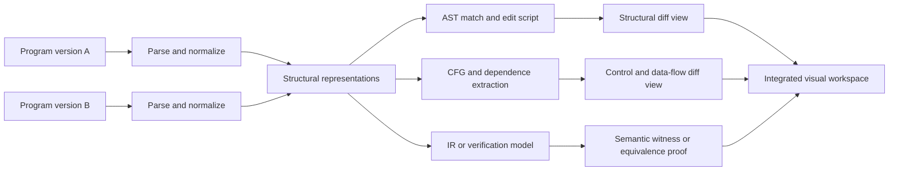
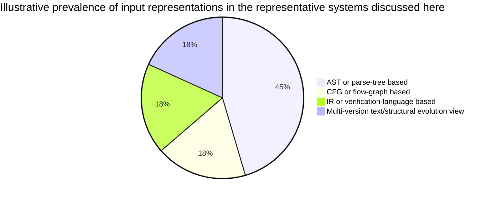

# Visualizing Control Flow and Data Flow Change Across Program Edits

## Executive summary

Program differencing has evolved from line-oriented comparison to a spectrum of increasingly semantic techniques: grammar-aware sequence differencing, AST differencing, control-flow and dependence-graph differencing, relational equivalence checking, and symbolic or SMT-backed semantic differencing. The foundational shift is from asking “what text changed?” to asking “what program structure, behavior, control dependence, and data dependence changed?” Early work by Horwitz framed the distinction between textual and semantic change; Yang showed how syntax-aware comparison improves over generic file diff; and PDG/SDG research provided a formal substrate for change reasoning over control and data dependencies rather than raw text. citeturn6search4turn6search7turn3view4turn3view5turn24search1

For **computing control-flow and data-flow diffs**, the literature converges on a few strong families. AST tools such as ChangeDistiller, GumTree, RefactoringMiner-based AST diff, srcDiff, and Difftastic produce fine-grained structural edits that are easier to visualize and less sensitive to formatting noise than line diffs. For control-flow-aware differencing, JDiff constructs **extended CFGs** for object-oriented programs and matches collapsed “hammock” regions. For semantic differencing, classical Semantic Diff summarized behavioral effects via input/output dependencies, while SymDiff, DiffKemp, and differential symbolic execution moved the field toward SMT-based equivalence checking, semantic witnesses, IR normalization, and pattern-aware matching. citeturn38search0turn1search2turn7search9turn20view0turn15view0turn41view0turn36view0turn36view1turn34view0turn42view0turn25search2turn27search0

For **visualization**, the dominant design space is well captured by comparative-visualization theory: **juxtaposition** (side-by-side views), **superposition** (overlay or merged space), and **explicit encoding of relationships** (direct links, difference glyphs, matched colors). In practice, code-diff systems overwhelmingly use side-by-side or unified views for source edits; graph-based systems such as BinDiff and CFG tools use node-link diagrams with explicit encodings for matched, changed, and unmatched blocks; and multi-version tools such as Code Flows use continuity-preserving bands or tubes to show how entities move, split, merge, drift, and persist across versions. citeturn32view0turn30search0turn13view4turn13view1turn14view1turn14view3

A central practical conclusion from the literature is that **better differencing algorithms and better visualizations must be co-designed**. Even precise analyses can overwhelm reviewers if they surface too many false positives or unstable layouts. Hanam, Mesbah, and Holmes found that traditional dependency-based impact views often did not help developers, whereas a semantics-aware change-impact representation reduced false positives and substantially improved review-task completion times. Likewise, JDiff, DiffKemp, HyperDiff, and the improved GumTree line of work show that scalability is not only a backend issue: it directly determines whether a visual diff can remain stable, interactive, and cognitively manageable. citeturn40view0turn37view0turn42view0turn19search0turn7search9

## Foundations and formal models

At the formal level, a “program diff” can be modeled in several ways. The simplest model is an **edit script** over a linear token or line sequence. A more structured model is an edit script over trees, typically ASTs. More behavior-oriented models treat a diff as a relation between control-flow graphs, program dependence graphs, or two program semantics. Ramalingam and Reps explicitly treated modifications algebraically, giving a formal lens for reasoning about program modifications instead of only artifacts of textual editing. citeturn24search1turn6search4turn6search7

Horwitz’s classic work drew an important distinction between **textual differences** and **semantic differences**: two versions may differ in text yet preserve behavior, or differ behaviorally even when the textual edit appears local. That distinction remains the conceptual backbone of modern semantic diffing and explains why simple file diff often fails as a representation of behavioral change. citeturn6search4turn6search2

For representing control and data flow, the foundational abstraction is the **Program Dependence Graph**. Ferrante, Ottenstein, and Warren defined the PDG as a representation that makes both **data dependences** and **control dependences** explicit; Horwitz and Reps later emphasized PDGs and SDGs as language-independent representations suitable for understanding behavioral differences across versions. In a PDG, nodes represent statements or predicates, and edges capture data values or control conditions that execution depends on. This explicit dependence structure is what makes PDG-based differencing attractive for change-impact analysis and semantic visualization. citeturn3view4turn3view5

For object-oriented differencing, JDiff demonstrates a useful formal refinement: the **Extended Control-Flow Graph**. Its ECFG extends the traditional CFG so that dynamic binding, exceptions, and synchronization can be represented in a way that more faithfully captures behavioral effects of source edits in Java. That matters because an apparently local edit, such as method redefinition under dynamic dispatch, may alter behavior at distant call sites that would not stand out in a purely textual diff. citeturn36view0turn4view1

For semantic differencing, the formal target is usually **relational semantics**: whether two procedures are equivalent, partially equivalent, or differ on some input/output relation. SymDiff makes this explicit by compiling programs to Boogie and checking whether matched procedures produce identical output states under the same input states. DiffKemp does something similar over LLVM IR for large C codebases, but with a pragmatic combination of normalization, instruction-wise comparison, and recognized semantics-preserving patterns. citeturn34view0turn42view0

The diagram above captures the architecture implicitly shared by many modern systems: structural differencing for precise localization, flow/dependence analysis for impact, and semantic checking for witness generation or equivalence claims. JDiff, SymDiff, DiffKemp, and semantic change-impact tools instantiate different slices of this pipeline. citeturn36view3turn34view0turn42view0turn40view0

The table below summarizes the main formal families.

| Family | Input representation | Formal object being compared | What it captures best | Typical limitations | Representative sources |
|---|---|---|---|---|---|
| Textual differencing | Lines / tokens | Sequence edit script | Precise textual patching and mergeability | Poor behavioral correspondence; formatting noise | Horwitz on textual vs semantic difference citeturn6search4 |
| Syntax-aware sequence differencing | Parse trees / grammar productions | Grammar-respecting correspondence | Better localization than generic diff | Still weak on nonlocal semantic effects | Yang 1991 citeturn6search7 |
| AST differencing | AST | Tree mapping + edit script | Fine-grained structural edits, moves, renames | Depends on parser quality and matching heuristics | ChangeDistiller, GumTree, RM-ASTDiff, srcDiff citeturn38search0turn1search2turn20view0turn15view0 |
| CFG / ECFG differencing | CFG / ECFG | Graph correspondence over control structure | Changes in dispatch, exceptions, synchronization, branch structure | Hard layout, graph matching cost, language-specific modeling | JDiff citeturn36view0turn36view1turn36view3 |
| PDG / SDG differencing | Dependence graphs | Behavioral slice or dependence relation changes | Control and data dependence changes, impact analysis | Construction cost; precision depends on analysis | PDG/SDG foundations citeturn3view4turn3view5 |
| Semantic / relational differencing | IR, verification language, symbolic paths | Equivalence or differential property | Witnesses for behavioral change and equivalence | Solver/path complexity, loop/heap modeling | Semantic Diff, SymDiff, differential symbolic execution, DiffKemp citeturn25search2turn34view0turn27search0turn42view0 |

## Algorithms for computing control-flow and data-flow diffs

The canonical early syntax-aware algorithm in this area is Yang’s dynamic-programming approach for identifying syntactic differences between programs. Its key contribution was to exploit grammatical structure so that the comparison aligns with program syntax instead of arbitrary line boundaries. That idea directly influenced later tree-based differencing systems. citeturn6search7

A major step forward came with **ChangeDistiller**, which improved Chawathe-style tree differencing for fine-grained source-code change extraction. Its model is explicit: compare two ASTs, compute node matches, derive a minimum edit script, and then classify the result using a taxonomy of source-code changes. The ChangeDistiller work is especially important because it tied differencing to downstream empirical software-engineering tasks rather than treating the edit script as an end in itself. citeturn38search0turn3view3

**GumTree** became influential because it made AST differencing both practical and developer-facing. The ASE 2014 paper described it as a fine-grained, accurate source-code differencing algorithm evaluated on 1,000 real file modifications from 16 Java projects, outperforming competing algorithms while remaining competitive in execution time. Later work in 2024 revisited GumTree’s heuristics to improve quality while also scaling to larger ASTs and multiple datasets across two languages. In other words, GumTree represents the mainstream “high-quality AST mapping under real-world constraints” line of research. citeturn1search2turn1search14turn7search9

More recent AST research has tried to fix exactly the cases developers complain about: refactorings, multi-mapping, semantically incompatible matches, and commit-level differencing. The RefactoringMiner-based AST diff work by Alikhanifard and Tsantalis explicitly targets those shortcomings, adds refactoring awareness, and evaluates on the first benchmark of AST node mappings containing **800 bug-fixing commits** and **188 refactoring commits**, reporting higher precision and recall than prior tools, especially on refactoring-heavy changes. citeturn20view0turn10search7

For control-flow-aware source differencing, **JDiff** is the key primary source. CalcDiff aligns classes and methods, constructs ECFGs for matched methods, collapses them into nested hammock regions, and then invokes a hammock-matching procedure with configurable lookahead and similarity thresholds. The ECFG model captures OO features such as dynamic binding, exception flow, and synchronization; the matching algorithm recursively compares hammock regions and can use lookahead to recover alignments after local structural displacement. In the paper’s worst-case analysis, complexity depends on matched nodes, hammock nesting depth, and lookahead, with the general form \(O(k \cdot \min(d,l) \cdot \min(m,n))\). citeturn36view3turn36view0turn36view1turn37view0

At the semantic end of the spectrum, **Semantic Diff** and **SymDiff** aim to characterize what changed behaviorally rather than structurally. Jackson and Ladd’s 1994 Semantic Diff summarized the effects of modifications via semantic relations rather than raw syntax; later work, especially SymDiff, shifted semantic differencing to **relational verification**. SymDiff compiles programs to Boogie, pairs procedures, constructs an equivalence-checking procedure over matched pairs, and asks whether outputs and modified globals agree for terminating executions under the same inputs. It can optionally inline callees, replace calls with uninterpreted summaries, and, crucially for visualization, generate **abstract counterexample traces** that highlight intra-procedural paths and relevant expression values as semantic witnesses. citeturn25search2turn34view0

A related but distinct semantic family uses **symbolic execution**. Differential symbolic execution—explicitly cited by SymDiff as the closest path-enumerative alternative—focuses on enumerating path divergences between versions. The contrast is instructive: symbolic execution often gives very concrete path witnesses, while SMT-based verification approaches can be more scalable on heavily branching procedures if they avoid exhaustive path enumeration. citeturn34view0turn27search0

For large C systems, **DiffKemp** offers a modern engineering compromise between pure equivalence checking and pure structural matching. It compiles compared versions to LLVM IR, performs semantic-preserving normalizations such as constant propagation and dead-code elimination, compares instruction-by-instruction when possible, and then reasons about remaining differences using built-in semantics-preserving patterns such as inverse branches, code relocation, structure-layout changes, or extracted helper functions. It also allows user-defined change patterns expressed over parametrized CFGs. This is an especially relevant design for flow-diff visualization because it can distinguish *known-safe structural rewrites* from true semantic changes before the UI ever renders them. citeturn42view0turn41view1

For binaries, **BinDiff** is the best-known representative. The official project page describes it as a graph-theoretical comparison tool for executables, identifying identical and similar functions. The current open-source repository describes it as a tool for quickly finding differences and similarities in disassembled code, and its manual shows a flow-graph GUI in which green nodes denote identical instruction mnemonics, yellow nodes denote matched-but-changed basic blocks, and red nodes denote unmatched blocks. This makes binary diffing one of the clearest examples of control-flow delta visualization in production practice. citeturn7search5turn7search2turn13view4

The systems landscape also includes practical structural tools that are not research papers but matter in practice. **Difftastic** uses syntax-aware structural comparison, treats diffing as a graph problem solved with Dijkstra’s algorithm, and uses tree-sitter parsers; it supports many languages, but its own documentation warns that it can scale poorly on files with many changes and can use substantial memory. That self-reported tradeoff is representative of a broader reality: richer structure almost always improves diff quality, but not for free. citeturn41view0

Finally, scaling the computation itself has become a research topic. **HyperDiff** explicitly targets source-code diff generation at large scale, using time-oriented data structures so differencing remains tractable on very large codebases. Even though HyperDiff is not itself a visualization paper, it is a critical backend result because interactive visual comparison becomes impossible once diff computation exceeds review-time budgets. citeturn19search0turn7search7

## Visualization and interaction design space

Comparative-visualization research offers a clean conceptual vocabulary for code-diff UIs. The high-level categories are **juxtaposition** (separate spaces, such as side-by-side panes), **superposition** (shared space, such as overlay or merged view), and **explicit representation of relationships** (link lines, match bands, or glyphs encoding correspondence). The same literature also emphasizes that interaction is not optional; it is often necessary to bring comparable items together, filter clutter, or steer the underlying comparison algorithm. citeturn32view0turn30search0

In code differencing, **juxtaposition** remains dominant because it preserves source readability and supports precise patch review. srcDiff explicitly supports unified, side-by-side, terminal, and HTML outputs, while preserving whitespace, comments, and preprocessor directives in a single multi-version XML representation. SEMCIA’s evaluation interface also uses a split-view presentation with aligned old/new files, context expansion for hidden unchanged lines, and menu-based retrieval of slices or semantic impact relations. These tools show why source-review workflows still favor aligned panes even when the underlying differencing algorithm is deeply structural. citeturn15view0turn40view0

**Merged and explicit-encoding views** become more important when the goal is not editing but understanding. Code Flows is the clearest example: it renders consecutive versions as icicle-like structural layers and connects matched code fragments with colored spline “tubes,” making unchanged continuity visible while also surfacing drift, splits, merges, insertions, and deletions. The paper explicitly argues that line-oriented text displays are not scalable and cannot easily show merge, split, or drift patterns. Its design adds brushing to reveal underlying code text, making a useful combination of overview and detail. citeturn13view1turn14view3turn14view1

**Node-link graph views** are the natural choice when the subject of comparison is control flow or dependence structure. BinDiff’s graph GUI exemplifies this by coloring matched and unmatched basic blocks and allowing synchronized or unsynchronized navigation across the two versions. SymDiff takes a related but more semantics-oriented route: rather than showing whole graphs, it highlights a semantically distinguishing path and annotates expressions with values along the trace. That is effectively a “semantic witness view” rather than a pure structural graph diff, and in practice it may be cognitively cheaper than rendering two full PDGs. citeturn13view4turn34view0

Graph readability itself is a distinct research problem. VEIL argues that generic graph layouts often violate developers’ expectations of execution order, and proposes CFG-specific criteria and a dominator-based layout that better preserves top-to-bottom “happens-before” intuition. The paper lists familiar graph-drawing criteria—crossings, bends, area, symmetry, consistent flow—but then adds control-flow-specific considerations grounded in the way developers read source code. This matters directly for diff visualization: a visually unstable or semantically unintuitive layout can erase much of the value of a precise underlying diff. citeturn13view3

The color and encoding conventions used across tools are fairly consistent. Insertions and deletions are typically mapped to green and red in source views. BinDiff uses green for identical basic blocks, yellow for matched-but-modified blocks, and red for blocks for which no equivalent was found. Code Flows uses persistent color identity to help users trace fragments across versions, with icons and correspondence highlighting for special events such as splits, merges, and drift. These choices exploit preattentive cues, but they also risk overloading color when there are too many categories or too many simultaneous correspondences. citeturn13view4turn14view3

The chart above is a synthesis over the representative systems discussed in this report, not a claim about the entire literature. It highlights a clear pattern: most systems still start from ASTs, while a smaller but highly important subset move to CFGs, dependence structures, or IR-level semantic models when behavioral precision matters.

From a design standpoint, the literature suggests a layered strategy. Use an AST or line-oriented source pane to preserve editability and readability; add explicit relationship encodings to show correspondences, moves, renames, or refactorings; attach on-demand control/data-flow context rather than rendering the whole flow graph by default; and surface semantic witnesses only when a reviewer asks “why does this change matter?” This recommendation is an inference from the surveyed systems and their respective strengths. citeturn15view0turn13view4turn40view0turn34view0turn14view3

## Representative tools, datasets, and evaluation landscape

A striking theme in the literature is that **evaluation criteria differ by layer**. Tree-diff papers emphasize node-mapping precision, recall, compactness of edit scripts, and runtime. Flow- or dependence-aware papers emphasize coverage estimation, precision of impact sets, or correctness of matched graph regions. Semantic tools measure proof success, counterexample quality, false positives, and runtime under solver or path-explosion constraints. Visualization work adds user-task time, correctness, and subjective comprehensibility. citeturn38search0turn1search14turn20view0turn37view0turn34view0turn40view0

The most robust recent AST benchmark in the surveyed material is the RefactoringMiner-based AST diff benchmark: **800 bug-fixing commits** and **188 refactoring commits** with AST node mappings, explicitly built to compare mapping accuracy across tools. By contrast, GumTree’s earlier evaluation used **1,000 real file modifications from 16 Java projects**, mostly emphasizing edit-script quality and runtime. srcDiff reports wall-clock comparisons on **1,307 Java file pairs from Jenkins** plus a stress test that concatenates all files together to highlight scalability. citeturn20view0turn1search14turn15view0

JDiff’s evaluation is unusually concrete about downstream utility. On the JABA program—about **550 classes, 2,800 methods, and roughly 60 KLOC**—it used correspondences between ECFG nodes to estimate test coverage across versions. The paper reports high coverage-estimation accuracy, with several version pairs exceeding **96% correct at the test-suite level** and about **98% at the average test-case level** in the reported settings. That is a useful reminder that control-flow-aware diffing is not only about prettier graphs; it can support regression engineering tasks directly. citeturn37view0

SymDiff evaluates scalability in terms of feasible paths and solver time, reporting that the tool scales well for finding differences when intraprocedural path counts are below about 1,000 and noting successful application to C programs several thousand lines long. It also cites the **Software-artifact Infrastructure Repository** as part of its evaluation ecosystem. DiffKemp’s evaluation is even more deployment-oriented: for multiple RHEL kernel version pairs, it compares **thousands of functions** and **tens to hundreds of thousands of lines** in runtimes on the order of minutes, which is impressive for semantic comparison of system code. citeturn34view0turn42view0

User studies are comparatively rarer but especially important for visualization. Hanam, Mesbah, and Holmes first found no evidence that traditional dependency-based change-impact views improved code-change understanding, then introduced SEMCIA, whose semantic relations reduced false positives and improved task completion time by **30–90%** in their code-review tasks. Comparative-comprehension work outside the diff literature further shows that developers integrate textual, structural, and naming cues when comparing alternatives, which supports the case for multi-layer diff views rather than single-representation displays. citeturn40view0turn13view2

The next table compares representative systems across the dimensions you asked for.

| Tool / system | Input representation | Diff algorithm | Visualization type | Interactivity | Scalability / performance notes | Evaluation and datasets |
|---|---|---|---|---|---|---|
| ChangeDistiller citeturn38search0turn3view3 | Java AST | Chawathe-style tree differencing + taxonomy of change types | Mostly downstream change extraction; not primarily a graph UI | Historically plugin-based extraction workflows | Better approximation of minimum edit scripts than predecessor; focused on extraction quality | Fine-grained change taxonomy with 35 change types; empirical evaluation in TSE paper |
| GumTree citeturn1search2turn7search9turn41view2 | AST | Heuristic tree mapping with move/rename detection | File and directory viewers; source-oriented diff | Git integration; file browsing | Competitive runtime; 2024 work explicitly improves scalability to larger ASTs | 1,000 file modifications from 16 Java projects; later evaluation on four datasets and two languages |
| JDiff citeturn36view0turn36view1turn37view0 | Java classes, methods, ECFGs | Hammock-based ECFG matching with lookahead | Structural/graph-oriented; outputs matched classes, methods, nodes | Primarily analysis output, but intended for impact/regression tasks | Worst-case complexity analyzed; implemented atop JABA | JABA program, CVS versions, 707-test-suite study, coverage-estimation accuracy |
| SymDiff citeturn34view0 | Boogie IR from C/C#/x86 | Relational equivalence checking with SMT, optional inlining, counterexample extraction | Semantic witness view with highlighted traces and expression values | Counterexample-driven exploration of differing paths | Scales well below ~1,000 intraprocedural paths; applied to C programs thousands of lines long | Includes path-enumeration timing; cites SIR in evaluation context |
| BinDiff citeturn7search2turn7search5turn13view4 | Disassembled binaries, function flow graphs | Graph-theoretical function and block matching | Node-link binary CFG diff | Similarity sorting, graph launch, synchronized/unsynchronized panning | Production-strength binary diff; open source as of 2023 | Widely used in reverse engineering; manual demonstrates patch-analysis workflow |
| DiffKemp citeturn42view0turn41view1 | LLVM IR for C | Normalization + instruction-wise comparison + semantic patterns + graph matching for custom patterns | Primarily report-oriented; returns verdicts and causing diffs | Function/parameter selection; customizable ignore patterns | Thousands of functions in minutes on kernel-scale comparisons | RHEL KABI studies across several kernel version pairs |
| SEMCIA citeturn40view0 | Partial JavaScript AST + semantic relations + slices | Semantic change-impact relations over structural changes | Split-view source diff with semantic context | Context menu, on-demand slices/relations, hidden-context expansion | Designed for partial intra-file analysis to fit review workflows | 2,000 commits from three NodeJS apps; false-positive reduction and user study |
| srcDiff citeturn15view0 | srcML XML AST with full source preservation | Rule-driven syntactic differencing during AST traversal | Unified, side-by-side, terminal, and HTML views | Queryable XML, XPath, theme customization | Fast on 1,307 file pairs; stress test succeeds where several tools fail | Jenkins-derived file-pair benchmark and stress test |
| Code Flows citeturn13view1turn14view3 | Matched syntax hierarchies across versions | Structure tracking over matched code blocks | Multi-version merged flow view with colored tubes | Brushing, event highlighting | Scales better than plain text for multi-version overview, though not a full codebase-scale diff engine | 6 versions of ~6,000 lines of C++ in the paper’s case study |
| Difftastic citeturn41view0 | Syntax trees via tree-sitter | Structural diff framed as a graph problem using Dijkstra’s algorithm | Source-oriented side-by-side structural diff | CLI, VCS integration, merge-conflict understanding | Documentation warns of poor scaling and high memory on very large edits | Practice-oriented tool; emphasizes human-readable output rather than benchmark science |

A notable absence in this table is a mature, widely adopted tool that shows **source diff, control-flow delta, data-flow delta, and semantic witness in one integrated visual workspace**. Some research prototypes cover two or three of those layers well, but very few cover all four. That gap is an inference from the surveyed systems rather than a direct claim from any one source. citeturn15view0turn13view4turn34view0turn40view0turn13view1

## Research gaps and recommendations

The first major gap is **end-to-end integration**. Most source-code diff tools stop at structural edits; most semantic tools stop at proofs or witnesses; most graph-diff tools show control flow but not developer-facing source context. Yet reviewers need all three: where the edit is, how it propagates through control/data dependencies, and whether any behavioral witness actually distinguishes the versions. The field has excellent components, but relatively few integrated systems. citeturn15view0turn34view0turn13view4turn40view0

The second gap is **stable layout and stable identity**. Control-flow or dependence-graph diffs quickly become unreadable when layout changes more than the underlying graph. VEIL’s emphasis on execution-order-preserving aesthetics and Code Flows’ emphasis on continuity are both responses to this problem, but direct research on *stable graph layouts across edits* for program-diff tasks remains limited compared with the sophistication of the underlying differencing algorithms. citeturn13view3turn13view1

The third gap is **evaluation realism**. Algorithm papers often report precision, recall, runtime, or compactness, but only a minority evaluate whether the visualization actually helps the intended tasks. Hanam et al. are an important exception because they directly test review performance. More studies of review, debugging, regression analysis, security patch analysis, and refactoring understanding are needed, with task-specific success metrics rather than generic usability questionnaires. citeturn40view0turn13view2

The fourth gap is **benchmark fragmentation**. AST-diff benchmarks, semantic-equivalence benchmarks, binary-patch corpora, code-review datasets, and graph-visualization tasks are usually separate. That makes it difficult to compare a semantic diff tool with a structural diff tool in terms that matter to a human reviewer. The RM-ASTDiff benchmark, GumTree studies, JABA-based JDiff evaluation, RHEL KABI studies, SIR-based semantic studies, and Jenkins-based srcDiff evaluations are all useful, but they are not aligned into a common benchmark suite. citeturn20view0turn1search14turn37view0turn34view0turn42view0turn15view0

The fifth gap is **uncertainty representation**. DiffKemp openly reports that it is incomplete and may produce false positives, especially around complex refactorings. Semantic tools, static change-impact tools, and graph matchers all have failure modes, yet most visualizations still present their outputs as if correspondences were certain. For high-stakes analysis, especially at binary or security-patch level, visual encodings for confidence, unproven equivalence, ambiguous mappings, or unmatched-but-possibly-related regions would be a major improvement. citeturn41view1turn42view0

On the basis of the survey, the most promising design recommendations are these. First, use a **multi-layer architecture**: AST diff for localization, flow/dependence analysis for propagation, and semantic checking for witness generation. Second, keep the **primary view source-centric**, but allow opt-in expansion to flow graphs and semantic traces. Third, use **stable IDs and stable layouts** so unchanged structure stays visually fixed across versions. Fourth, expose **confidence and provenance** for each mapping or semantic claim. Fifth, evaluate with **task-based human studies** in addition to algorithmic metrics. These recommendations are synthetic conclusions drawn from the strengths and weaknesses reported across the literature and tools cited throughout this report. citeturn41view2turn37view0turn34view0turn13view3turn40view0turn42view0

The broader research opportunity is clear: the community already knows how to compute high-quality structural diffs, how to reason about dependence and equivalence, and how to design effective comparative visualizations. What is still missing is a new generation of systems that combine those capabilities into review-time tools that scale to industrial repositories, preserve mental maps, and explain—not just display—how control and data flow changed between edits. citeturn7search9turn19search0turn32view0turn13view3turn40view0turn34view0