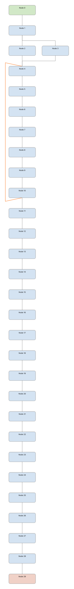

# M0 validation evidence

Date: 2026-08-04

Status: passed

## Gate results

- `swift test`: passed, 22 XCTest cases, 0 failures.
- `swift build -c release`: passed.
- Parser/CFG spike: the representative Swift fixture covers `guard`, `if`/`else`, `switch`, `for`, `repeat`, `do`/`catch`, `defer`, plain `try`, `return`, `throw`, `break`, and `continue`.
- Matcher spike: all three entity tiers and GumTree insert/update behavior pass; the provenance manifest contains 20 unique audit entries from `swift-syntax` and `swift-nio`.
- End-to-end spike: an exact `swift-syntax` old/new function excerpt passes parse, entity triage, syntax matching, CFG construction, and layout.
- Layout spike: deterministic 30-node layout, stable anchor, back-edge routing, staged transition states, and a 120-iteration p95 check all pass. The enforced p95 ceiling is 16.67 ms.
- CALayer spike: 30 nodes and 31 edges render into an offscreen AppKit layer scene, and a changed graph installs staged Core Animation.

## Diagnostic still

`notes/artifacts/m0-30-node-cfg.png` is a 1000 × 7888 PNG generated by the render test. It was visually inspected after generation and shows the downward branch/merge plus an outside orange back-edge lane. No screen recording was made, per instruction.

## Gate findings resolved

1. The plain `tree-sitter-swift` 0.7.3 tag omits its generated parser. The package now pins the source-complete 0.7.3 release commit.
2. Swift keyword identifiers (`fallthrough`) were escaped in the public edge vocabulary and builder helper.
3. Local property declarations were incorrectly eligible as top-level entities while traversing function bodies. Callable-scope tracking now prevents that leak.
4. The matcher did not map a changed unique child when an inserted sibling displaced it. A conservative mapped-parent/unique-kind alignment pass now recovers the update mapping.
5. The 0.7.3 grammar parses `defer { ... }` as a call expression. Normalization now promotes the unambiguous `defer` callee form to `defer_statement`.
6. Back-edge routing reserved width but did not reserve the corresponding left-side origin. Layout now shifts ranks right by the required lane allowance.
